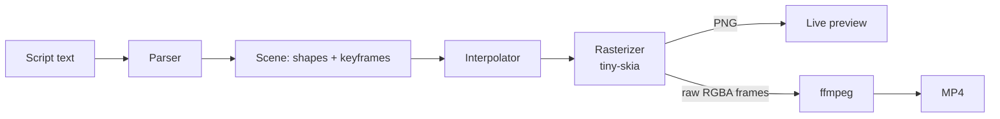

# Keyframe Studio *(working title)*

A tiny, keyframe-based **domain-specific language for describing videos**, with a desktop app that compiles scripts into real MP4 files.

You declare a handful of shapes, set their properties at points in time, and the compiler interpolates everything in between and renders it to video. The language is deliberately small and regular so that it is easy for **LLMs to write**, easy for humans to read, and easy to validate.

> **Status: early prototype (v0).** The language, renderer and app work end to end, but everything here is expected to change.

```
video 640 360 30 4
rect box 80 80 #ff5555
circle ball 30 #55aaff

at 0 box x=60  y=180 rot=0
at 4 box x=580 y=180 rot=360

at 0 ball x=320 y=40  scale=1
at 2 ball x=320 y=320 scale=2
at 4 ball x=320 y=40  scale=1
```

---

## Why

Most video tools are built around a GUI timeline, which is hard for an AI to drive. This project explores the opposite approach: a **text-first, declarative, keyframe-only** format that describes *what is on screen and when*, never *how to draw it*. That makes scripts:

- **Diffable**: they live in git like any other source file.
- **Deterministic**: the same script always produces the same frames.
- **Machine-writable**: a small grammar with clear errors makes generation and self-correction practical.

## How it works



- **Backend (Rust):** parses the script, evaluates every property at time `t`, rasterizes a frame with [`tiny-skia`](https://github.cyom/RazrFalcon/tiny-skia), and either returns it as a PNG (preview) or streams raw RGBA frames into `ffmpeg` (export).
- **Frontend (React + TypeScript):** a script editor, a preview with a scrubber and play/pause, and an export button with progress.
- Preview and export share the **same renderer**, so what you scrub is exactly what you export.

## The language (v0)

One statement per line. `//` starts a comment.

| Statement | Meaning |
|---|---|
| `video W H FPS DURATION` | Canvas size in pixels, frame rate, length in seconds. Required. |
| `rect NAME W H #rrggbb` | Declares a rectangle. |
| `circle NAME R #rrggbb` | Declares a circle. |
| `at TIME NAME prop=value ...` | Sets one or more properties of a shape at a point in time. |

### Properties

| Prop | Default | Meaning |
|---|---|---|
| `x`, `y` | `0` | Position of the shape's **center**, in pixels (origin top-left). |
| `rot` | `0` | Rotation in degrees. |
| `scale` | `1` | Uniform scale. |
| `opacity` | `1` | `0` to `1`. |

### Semantics

- Each property is interpolated **linearly and independently** between its keyframes.
- Before a property's first keyframe its first value is held; after its last, its last value is held.
- Shapes are drawn in **declaration order** (later shapes are on top).
- A shape must be declared before it can be keyed.
- Errors are reported with line numbers, e.g. `line 6: unknown shape 'bax'`.

## Getting started

### Prerequisites

- [Node.js](https://nodejs.org/) and [Rust](https://rustup.rs/)
- The [Tauri system prerequisites](https://tauri.app/start/prerequisites/) for your OS
- **`ffmpeg` on your `PATH`**, built with an H.264 encoder (`libx264`). Some distro builds omit it for licensing reasons. Check with:

  ```bash
  ffmpeg -encoders | grep 264
  ```

### Run

```bash
npm install
npm run tauri dev
```

Edit the script on the left, scrub or play the preview on the right, set an output path, and press **Export MP4**.

## Project layout

```
src/                 React frontend (App.tsx, App.css)
src-tauri/src/lib.rs Parser, interpolator, renderer, Tauri commands
```

All of the language logic currently lives in `lib.rs`; it will be split into its own crate as the project grows (see the roadmap).

## Known limitations

- Only `rect` and `circle`; no text, images, lines or groups.
- Linear interpolation only (no easing).
- Export needs an external `ffmpeg` with a usable H.264 encoder.
- The output path is a plain text field; no file dialog yet.
- Export cannot be cancelled.
- The parser is a simple line splitter, not a full grammar with a formal AST.

## Roadmap

**Near term**
- [ ] Encoder fallback when `libx264` is unavailable
- [ ] Easing functions (`ease=in_out` and friends)
- [ ] Native save dialog and cancellable export
- [ ] More shapes: `text`, `line`, `image`
- [ ] Layer / z-order control

**Language**
- [ ] Formal grammar and spec document
- [ ] A stable JSON intermediate representation (IR) that other tools can produce or consume
- [ ] Groups / parenting, reusable definitions

**AI authoring**
- [ ] Machine-readable schema and prompt kit for LLMs
- [ ] Validate-and-retry loop: feed parser errors back to the model
- [ ] Example library of scripts for few-shot prompting

**Architecture**
- [ ] Extract the compiler and renderer into a standalone Rust crate and CLI (`kfs render script.kf out.mp4`)
- [ ] Optional GPU renderer
- [ ] Alternative frontends (web via WASM, other desktop stacks)

## Contributing

Issues and ideas are welcome while the language is still taking shape. Because the spec is changing quickly, please open an issue to discuss before sending large pull requests.

## License

*TBD.*